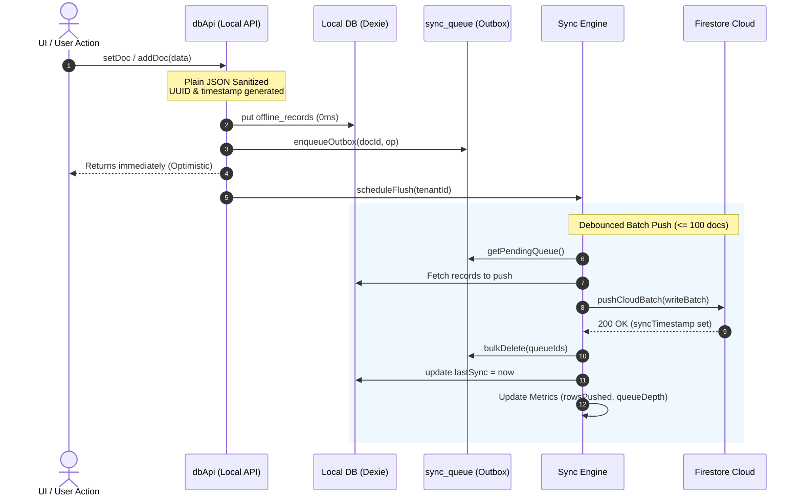
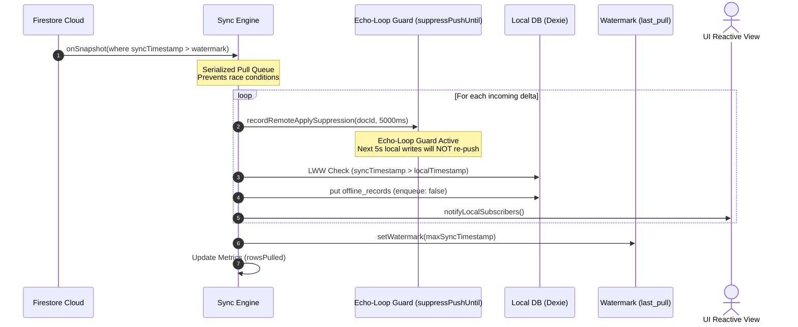

# CustomsTrack PRO (CCT) — Local-First Architecture & Bidirectional Sync Engine

CustomsTrack Pro is engineered with a **Local-First (Offline-First)** architecture. The user interface operates against a local reactive IndexedDB document store via Dexie with **0ms latency**. Changes are optimistically committed locally, buffered in a transactional outbox queue, and pushed to Cloud Firestore in batched chunks. Remote changes are incrementally pulled using a watermark cursor and applied locally with strict echo-loop suppression.

---

## Styling System

The UI is built from two cooperating layers:

- **`src/index.css`** — the hand-written design system (color/spacing tokens, `.btn-*`, `.data-table`, `.modal-box`, `.kpi-chip`, `.dossier-*`, …). Its rules are **unlayered**, so a class-based component style always wins over a utility class applied to the same element.
- **`src/tailwind.css`** + `@tailwindcss/vite` — Tailwind v4, the utility engine used by the views authored with utility classes (Loss Prevention Radar, Public Tracking Portal, Dossier drawer, shipment table and modals).

Rules to keep in mind when editing styles:

1. Element defaults (`body`, `h1`–`h6`, form controls) live in `@layer base`, so a utility such as `text-white` on an `h2` still wins.
2. The global margin/padding reset is owned by Tailwind's preflight, not by `index.css` — that is what allows utilities such as `p-6` / `mt-2` to take effect.
3. `src/tailwind.css` is imported **before** `index.css` in `src/main.jsx`, which establishes the layer order `theme → base → components → utilities`.

---

## BL Consignment Attachments

The **Documents** step of the BL dossier carries two upload slots — **BL Draft** and **Original BL** (either
one or both). Images (JPG/PNG/WebP) and PDF documents are accepted.

- **Compression** (`src/utils/fileCompression.js`) runs in the browser before anything leaves the device and
  targets a hard ceiling of **150 KB per file**. Images are re-encoded through the canvas API — the longest edge
  stays between 800 px and 1600 px and JPEG quality is searched from 0.82 down to 0.45, so quality is reduced only
  as far as the size budget requires. PDFs already under the ceiling are uploaded untouched; larger PDFs are
  rasterised page by page (width ladder adapted to the page count) and rebuilt as a JPEG based PDF until the
  result fits.
- **Storage layout**: `bl_documents/{companyId}/{shipmentId}/{slot}_{timestamp}.{ext}` in Firebase Storage,
  guarded by `storage.rules` (images/PDFs only, ≤ 150 KB per object).
- The attachment metadata (`name`, `size`, `originalSize`, `pages`, `url`, `path`, `uploadedBy`, `uploadedAt`) is
  saved on the shipment document as `blDocuments.blDraft` / `blDocuments.originalBL`, and is shown in the BL
  dossier front area (image thumbnail or PDF icon, size, who uploaded it, and a *View* link).
- `pdfjs-dist` and `jspdf` are imported on demand, so they stay out of the main bundle.

Deploy the storage rules whenever they change:

```bash
firebase deploy --only storage
```

---

## Sync Engine — How It Works

### Architecture Components
- **Local DB (`src/localDB.js`)**: Polymorphic single-table store (`offline_records`) and transactional outbox (`sync_queue`), isolated per tenant (`myapp_tenant_{tenantId}`).
- **Local API (`src/dbApi.js`)**: Firestore-shaped optimistic API (`addDoc`, `setDoc`, `updateDoc`, `deleteDoc`, `onSnapshot`). Writes return immediately without waiting for the network.
- **Outbox (`src/sync/outbox.js`)**: Transactional queue tracking pending mutations (`INSERT`, `UPDATE`, `DELETE`).
- **Sync Engine (`src/sync/engine.js`)**: Manages outbox draining (`flushPending`), incremental delta pulling (`applyRemoteDeltas`), echo-loop suppression, and conflict resolution.
- **Watermark Cursor (`src/sync/watermark.js`)**: Persists `last_pull_{tenantId}` in `localStorage` so devices only fetch changes where `syncTimestamp > watermark`.
- **Status Store (`src/sync/status.js`)**: Observable module-level store exposing `'offline' | 'connecting' | 'syncing' | 'connected' | 'error'` and live sync metrics.
- **Cloud Wrapper (`src/cloud.js`)**: Thin isolation layer wrapping Firebase SDK `writeBatch` (<= 100 docs/batch) and delta streams.

---

### Write Path: Local Write -> Outbox -> Push



---

### Pull Path: Remote Change -> Watermark -> Echo Guard -> Apply



---

## Security Rules & Row-Level Security (Firestore RLS Equivalent)

Deploy the following security rules in Firebase Firestore (`firestore.rules`) to guarantee multi-tenant cloud isolation:

```javascript
rules_version = '2';
service cloud.firestore {
  match /databases/{database}/documents {
    
    // Helper: Verify user is authenticated
    function isAuthenticated() {
      return request.auth != null;
    }
    
    // Helper: Verify user belongs to the requested tenant
    function isTenantMember(tenantId) {
      return isAuthenticated() && (
        request.auth.token.tenantId == tenantId ||
        request.auth.token.companyId == tenantId ||
        request.auth.uid == tenantId
      );
    }

    // Multi-tenant cloud records mirror: companies_live/{tenantId}/records/{id}
    match /companies_live/{tenantId}/records/{id} {
      allow read: if isTenantMember(tenantId);
      allow write: if isTenantMember(tenantId) 
        && request.resource.data.id == id
        && request.resource.data.syncTimestamp is number;
    }

    // Tenant discovery registry
    match /registry/{tenantId} {
      allow read: if isAuthenticated();
      allow write: if isTenantMember(tenantId);
    }
  }
}
```

---

## Conflict Resolution & Known Limitations

### 1. Last-Write-Wins (LWW) Tradeoff
- **Current Model**: The conflict resolution engine uses **Last-Write-Wins (LWW)** per document using `syncTimestamp`. If two devices edit the same document concurrently offline, the device whose sync is committed last on the server will overwrite the other device's fields.
- **Document-Level Loss Risk**: Edits to different fields in the same record by two separate offline users will result in the earlier edit being replaced by the later write.

### 2. Field-Level Merge (Opt-In Enabled)
- The sync engine includes a built-in opt-in field-level merger (`fieldLevelMergeCollections = new Set(['shipments', 'settings', 'masters'])`).
- When two non-deleted concurrent versions meet, non-conflicting top-level JSON fields are shallow-merged:
  ```javascript
  record.data = { ...(localRow.data || {}), ...(record.data || {}) };
  ```

### 3. Recommended Future Upgrade Paths
1. **JSON Merge-Patch (RFC 7396)**: Store field-level change vectors so that concurrent updates to different container rows or notes do not overwrite each other.
2. **State-based CRDTs (e.g., Yjs / Automerge)**: If real-time collaborative concurrent typing (e.g., multiple agents typing notes simultaneously on the same dossier) is required in the future, wire Yjs CRDT documents inside the polymorphic `data` payload.

---

## Verification Checklist

1. **Airplane Mode**: When offline (`navigator.onLine = false`), all creation, editing, and deletion operations succeed with **0ms latency** in local IndexedDB.
2. **Automatic Reconnect**: When network connectivity returns, `flushPending(tenantId)` automatically fires and drains queued records in batched chunks.
3. **Echo-Loop Guard**: Applied remote deltas have `enqueue: false` and are registered in `suppressPushUntil`, ensuring **0 circular outbox writes**.
4. **Idempotency**: Running `flushPending()` repeatedly is safe and idempotent because flushed entries are deleted from `sync_queue` and marked with `lastSync`.
5. **Cold Start**: The application displays instant UI directly from local IndexedDB without waiting on any cloud roundtrips.
